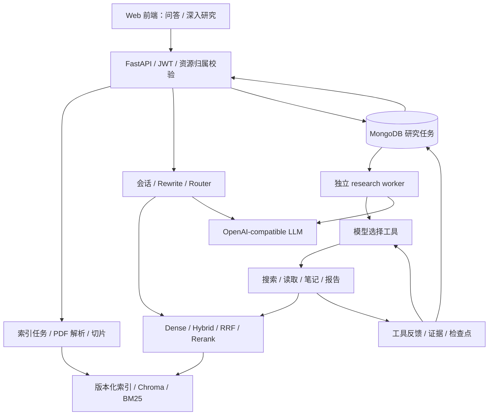

# DocRAG Agent

面向论文、技术文档和课程资料的多文档 PDF 阅读助手。支持知识库问答、混合检索、原文引用，以及通过工具反馈循环完成复杂问题的单 Agent Harness。

在同一个输入框中选择 **问答** 或 **深入研究**：前者检索后生成回答，后者允许模型根据证据缺口继续检索、读取原文、保存笔记并提交报告。

[在线体验](https://maoxiao-1205-medrag.hf.space/) · [Space 仓库](https://huggingface.co/spaces/maoxiao-1205/medrag) · [API 文档](https://maoxiao-1205-medrag.hf.space/docs) · [演示脚本](medrag/docs/demo-script.md)

## 当前状态

截至 **2026-10-19**：

- 多文档 RAG、索引版本管理、知识库和会话持久化已实现。
- 单 Agent Harness、独立研究 worker、任务与证据持久化、继续研究和历史删除已实现。
- 本地与 Docker 均使用统一入口，一条命令启动 API 和研究 worker。
- HF Space 已更新：本轮检查为 `RUNNING`，OpenAPI 中已有研究接口；线上 Dockerfile、统一启动脚本和 worker 文件与本地一致。
- H4 三题九组真实模型对照已完成，结果见下文。

本轮只核对了线上状态、接口和上述源码，没有重新执行完整的线上研究任务或全量 pytest。

## 核心能力

### 多文档 RAG

| 能力 | 实现 |
| --- | --- |
| PDF 解析 | PyMuPDF 按页提取，低文本量页面可选 Tesseract OCR 回退 |
| 切片 | Fixed / Recursive，保存页码、字符范围、策略和版本 |
| 索引管理 | 文件 hash 去重、index fingerprint、generation 写入与 active generation 切换 |
| 异步索引 | MongoDB ingestion job，202 + job_id、状态查询、重试、幂等与强制重建 |
| 检索 | Dense 或 BM25 + Dense Hybrid，RRF 融合与去重 |
| 重排与证据 | CrossEncoder Rerank、可配置证据阈值、来源与引用持久化 |
| 问题理解 | Query Rewrite、任务 Router、Summary Multi-Query |
| 知识库与会话 | 多知识库、多文档范围、历史消息与来源查看 |
| 认证与隔离 | JWT + Argon2，按认证用户校验资源归属 |

### 单 Agent Harness

Harness 管理模型执行任务的运行循环：固定可用工具与文档范围，把工具结果反馈给模型，并保存执行状态。

| 工具 | 作用 |
| --- | --- |
| `search_documents` | 在固定文档与索引范围内检索证据 |
| `read_evidence` | 读取已检索证据的原文内容 |
| `save_research_note` | 保存子问题、结论、证据和待解决问题 |
| `finish_report` | 提交带引用的结论与未解决事项 |

运行层负责：

- 固定认证用户、知识库、文档 ID 与索引 generation；原范围变化时停止任务。
- MongoDB 持久化任务、步骤、证据与检查点，独立 worker 通过租约领取和恢复任务。
- 管理模型请求、工具执行和时间预算，支持取消及异常记录。
- 抑制无新证据的重复检索，将证据与研究笔记反馈给后续决策。
- 继续研究时关联上一任务，沿用原文档范围与有限上下文，新任务独立计预算。

| 新任务默认预算 | 上限 |
| --- | --- |
| 单次模型请求 | 600 秒 |
| 任务总时限 | 5400 秒，即 90 分钟，包含排队 |
| 模型请求 | 8 次 |
| 工具执行 | 12 次 |

已有任务保留创建时保存的预算。以上为上限，任务可能因完成、次数耗尽或模型错误提前结束。

### 前端交互

- 问答和深入研究共用输入框、知识库与文档选择。
- 研究过程可折叠，展示实际工具步骤、状态和证据来源。
- 点击引用查看文件名、页码和原文。
- 当前报告下可继续研究；“新研究”按当前侧栏范围创建独立任务。
- 历史会话和研究记录支持折叠、查看与删除；运行中研究需先取消。

## 系统架构



MongoDB 保存业务元数据、会话、研究状态和证据；Chroma 保存向量与 chunk metadata；文件系统保存上传文件。研究 worker 是独立进程，PDF ingestion worker 当前仍在 API 进程内。

**技术栈：** Python 3.11、FastAPI、Uvicorn、PyMuPDF、Chroma、BM25、RRF、Sentence Transformers CrossEncoder、MongoDB / PyMongo、HTML / CSS / JavaScript、Docker。

默认 Embedding 为 SiliconFlow API 的 `BAAI/bge-m3`，Reranker 为 `BAAI/bge-reranker-base`；Rewrite 与 Answer 通过 OpenAI-compatible API 分别配置。

## 本地运行

### 1. 安装依赖与配置

Windows PowerShell，要求已安装 Conda；已有 `medrag` 环境可跳过创建。

```powershell
cd D:\MedRag
conda create -n medrag python=3.11 -y
conda activate medrag
python -m pip install -r medrag/backend/requirements.txt

if (!(Test-Path medrag/backend/.env)) {
    Copy-Item medrag/backend/.env.example medrag/backend/.env
}
```

编辑 `medrag/backend/.env`，完整字段见 [.env.example](medrag/backend/.env.example)。至少确认：

| 配置 | 说明 |
| --- | --- |
| `MONGODB_URI`、`MONGODB_DB_NAME` | 可连接的 MongoDB；研究事务需要副本集或 Atlas |
| `CHROMA_DIR`、`UPLOAD_DIR` | 当前环境的向量库目录和上传目录 |
| `JWT_SECRET_KEY` | 足够长的随机密钥 |
| `EMBEDDING_API_KEY`、`EMBEDDING_API_BASE`、`EMBEDDING_MODEL` | Embedding 配置 |
| `ANSWER_LLM_API_KEY`、`ANSWER_LLM_BASE_URL`、`ANSWER_LLM_MODEL` | 回答与研究模型；深入研究要求支持 function/tool calling |
| `REWRITE_LLM_API_KEY`、`REWRITE_LLM_BASE_URL`、`REWRITE_LLM_MODEL` | Rewrite 模型，可与回答模型使用同一供应商 |
| `RETRIEVAL_MODE` | `dense` 或 `hybrid`；示例文件默认为 `dense` |
| `OCR_ENABLED` | 无需 OCR 时可设为 `false` |

本地目录示例：

```env
CHROMA_DIR=D:/MedRag/runtime/chroma_bge_m3_api
UPLOAD_DIR=D:/MedRag/runtime/uploads
MONGODB_DB_NAME=medrag_local
```

Reranker 首次加载需下载模型。使用 OCR 时需安装 Tesseract 并配置语言包路径。本地与线上使用不同的数据库名和数据目录，不提交真实 `.env`、密钥、上传文件或索引。

### 2. 一条命令启动（推荐）

```powershell
cd D:\MedRag
conda activate medrag
python medrag/backend/start_services.py
```

统一入口启动 API 与研究 worker，前端由 API 提供，无需 npm 开发服务器。

- 页面：<http://127.0.0.1:8000/>
- API 文档：<http://127.0.0.1:8000/docs>
- 存活检查：<http://127.0.0.1:8000/health>
- 依赖就绪检查：<http://127.0.0.1:8000/ready>

### 启动（两个终端）

需要分别查看日志时可拆开启动，与统一入口二选一；先停止原进程，避免端口占用。

```powershell
# 终端 1：API 与前端
cd D:\MedRag\medrag\backend
conda activate medrag
python -m uvicorn main:app --host 127.0.0.1 --port 8000
```

```powershell
# 终端 2：研究 worker
cd D:\MedRag\medrag\backend
conda activate medrag
python -m harness.research_worker
```

仅启动 API 不会自动启动研究 worker，研究任务会等待领取。

## 使用与演示

1. 注册或登录，创建知识库并上传 PDF，等待索引完成。
2. 选择整个知识库或部分文档，用“问答”提出事实问题，点击引用核对原文。
3. 切换“深入研究”，输入需要多步查证的问题，展开过程查看工具执行。
4. 查看报告与来源，直接继续提问，或点击“新研究”切换任务范围。

三论文演示问题：

> 比较这三篇论文分别解决的问题、核心方法，以及实验结果为什么不能直接比较。逐项引用原文，证据不足的部分明确说明。

免费模型可能较慢，可先展示已有报告，再提交新任务展示执行过程。完整流程见 [演示脚本](medrag/docs/demo-script.md)。

## Hugging Face 部署与更新

原 Space：[`maoxiao-1205/medrag`](https://huggingface.co/spaces/maoxiao-1205/medrag)。Dockerfile 自动运行：

```text
python medrag/backend/start_services.py --host 0.0.0.0 --port 7860
```

同一容器启动 API 和研究 worker，对外提供 7860 端口，无需新建 Space。密钥放 Settings → Secrets，普通配置放 Variables，参见 [HF Docker Spaces 文档](https://huggingface.co/docs/hub/spaces-sdks-docker)。

### 从当前工作区上传

GitHub 推送和 HF 上传分别执行。本地文件不必先提交 Git，也不用新建临时目录。先用 `hf auth login` 登录有 Space 写权限的账号，再在 PowerShell 执行：

```powershell
cd D:\MedRag
conda activate medrag

@'
from huggingface_hub import HfApi

result = HfApi().upload_folder(
    repo_id="maoxiao-1205/medrag",
    repo_type="space",
    folder_path=".",
    allow_patterns=[
        "Dockerfile", ".dockerignore", "README.md",
        "medrag/backend/*.py",
        "medrag/backend/requirements.txt",
        "medrag/backend/.env.example",
        "medrag/frontend/*.js",
        "medrag/frontend/*.html",
        "medrag/frontend/*.css",
    ],
    ignore_patterns=["**/__pycache__/*", "**/.venv/*", "**/data/*"],
    commit_message="Deploy DocRAG Harness",
)
print(result.commit_url)
'@ | python -
```

此方式在 Python 内处理匹配规则，避开本机 `hf.exe` 通配符被提前展开的问题。上传更新匹配文件，不删除远端其他文件，也不修改 Secrets。

### 构建后检查

- Build logs 构建完成，运行日志出现 `service_started name=api` 和 `service_started name=research_worker`。
- 页面、`/health`、`/ready` 可访问，OpenAPI 包含 `/research-tasks`。
- 登录后提交研究任务，确认从排队进入执行，并能查看报告或明确的失败状态。

2026-10-19 核对时，Space 仓库与运行提交为 `eeb3cb5b8dc45590f52a9522e0041b7f65307123`；但 `/health` 的 `build_commit` 仍返回旧值 `8770e28ec88e5d7797e622117cd749eace20f168`。应用版本字段未随上传更新，不能单凭该字段判断源码是否同步。

## 实验结果

### H4：原有问答、固定检索与 Harness 对照

固定 RAG、LoRA、CoT 三篇论文及索引代次，使用 `Qwen/Qwen3.5-35B-A3B`，检索配置为 Hybrid + Rerank。三类问题为事实、三论文比较和无答案。

- A：原有问答，保留 Router、Rewrite 与原生检索展开。
- B：固定检索流程，原问题检索加逐文档固定查询，再生成一次回答。
- C：Harness，根据工具反馈继续选择动作，使用独立新任务。

三题共九组最终记录：**八组返回文本或报告，一组供应商 429 失败；八组返回结果中包含一组部分完成报告。**

三论文比较题的观察结果：

| 方案 | 回答来源覆盖 | 模型请求 | 原子检索次数 | 耗时 |
| --- | --- | --- | --- | --- |
| A 原有问答 | 1 篇 | 3 次 | 18 次 | 178 秒 |
| B 固定检索 | 2 篇 | 1 次 | 4 次 | 66 秒 |
| C Harness | 3 篇 | 8 次 | 7 次 | 441 秒 |

该样例中 Harness 扩大了文档覆盖，也增加了模型调用与等待。事实题 A/B 已能回答，本实验不能推出整体准确率提升。耗时含供应商等待、MongoDB 检查点与限流间隔；未逐条核验全部引用，也未进行本轮 Judge 评分。

初次 A 组受实验脚本检索上限影响的尝试已单独归档，修正后重跑 A；暂停的未完成尝试不计入九组最终记录。

- 实验入口：[harness_pilot.py](eval/runners/harness_pilot.py)
- 本机产物：`eval/runs/harness/h4_pilot_20261018/overview.json` 及各组 JSON。
- 实验任务使用隔离集合，结果不会自动出现在前端历史；运行产物不提交 Git。

### 基础 RAG 历史评估

2026-09-29 固定 20 题的历史记录如下，与本轮 Harness 对照分别统计：

| 指标 | 历史结果 |
| --- | --- |
| 接口执行 | 20/20，无 HTTP 500 |
| 证据召回 | 0.632 |
| Judge 正确性 / 完整性 | 0.855 / 0.786 |
| Judge 忠实性 / 引用正确性 | 0.989 / 0.933 |
| P95 延迟 | 约 199.9 秒 |

执行成功率不等于答案正确率，Judge 为辅助评估。详情见 [评估目录](eval/README.md) 与 [历史发布记录](medrag/docs/release-v1.1.0.md)，不把历史测试数量作为当前提交的测试结论。

## 主要接口

| 方法 | 路径 | 用途 |
| --- | --- | --- |
| GET | `/health`、`/ready` | 存活、版本与依赖检查 |
| POST | `/auth/register`、`/auth/login` | 注册与登录 |
| POST | `/pdf/index` | 创建或复用索引任务 |
| GET | `/ingestion-jobs/{job_id}` | 索引进度与错误 |
| POST | `/ingestion-jobs/{job_id}/retry` | 索引失败重试 |
| POST | `/knowledge-bases` | 创建知识库 |
| POST | `/conversations` | 创建会话 |
| POST | `/conversations/{id}/ask` | 检索问答 |
| GET | `/conversations/{id}/messages` | 历史消息和来源 |
| DELETE | `/conversations/{id}` | 删除会话及其消息和来源 |
| POST | `/research-tasks` | 创建研究任务，可传 `parent_task_id` 继续研究 |
| POST | `/research-tasks/{task_id}/run` | 加入研究队列 |
| GET | `/research-tasks/{task_id}` | 状态、步骤、报告与证据 |
| POST | `/research-tasks/{task_id}/cancel` | 取消任务 |
| DELETE | `/research-tasks/{task_id}` | 删除非排队、非运行中研究任务 |

请求字段和状态码以当前环境的 `/docs` 为准。

## 目录与验证入口

```text
MedRag/
├─ medrag/backend/
│  ├─ harness/            # 研究循环、工具、MongoDB 任务存储与 worker
│  ├─ routers/            # HTTP 接口
│  ├─ services/           # 解析、索引、检索、会话与模型调用
│  ├─ stores/             # 业务数据存储
│  └─ start_services.py   # API + research worker 统一入口
├─ medrag/frontend/       # HTML / CSS / JavaScript
├─ medrag/docs/           # 实现记录、项目说明和演示脚本
├─ eval/                  # 固定数据集、指标与实验 runner
├─ tests/                 # 单元、接口与 smoke 验证入口
├─ runtime/               # 本地数据，不提交 Git
└─ Dockerfile
```

静态检查：

```powershell
cd D:\MedRag
conda activate medrag
python -m compileall -q medrag/backend eval tests
git diff --check
```

验证入口包含 `tests/test_research_runner.py`、`tests/test_research_task_api.py`、`tests/test_research_tools.py`，以及研究恢复、连续追问、预算和前端 smoke 脚本。不同脚本使用的真实 MongoDB、fixture 模型或模拟接口范围不同，不能统称为真实模型端到端验证。

需要重新运行 pytest 时：

```powershell
python -m pip install -r requirements-dev.txt
python -m pytest -q
```

静态检查不替代测试。本次 README 更新未执行 pytest 或再次调用模型运行实验。

## 使用边界

- 报告完成状态主要检查结构与引用关联，不能保证每条结论均被原文语义支持；重要结论需回到引用核验。
- 研究记录入口目前保存在当前浏览器，完整任务保存在服务端，尚无跨设备历史发现列表。
- 模型可能限流或超时，研究任务可能部分完成；默认预算不保证一定生成完整报告。
- Space 休眠时 API 与 worker 都会停止；普通临时磁盘重启后可能丢失。MongoDB 的任务持久化不等于 Chroma 与上传文件已持久化，参见 [平台存储说明](https://huggingface.co/docs/hub/spaces-sdks-docker#data-persistence)。
- 暂无生产容量与并发基准；系统用于文档辅助阅读，不用于医学诊断。

## 进一步阅读

- [项目说明](medrag/docs/项目说明.md)
- [Harness 实现记录](medrag/docs/research-harness-h1.md)
- [演示脚本](medrag/docs/demo-script.md)
- [评估说明](eval/README.md)
