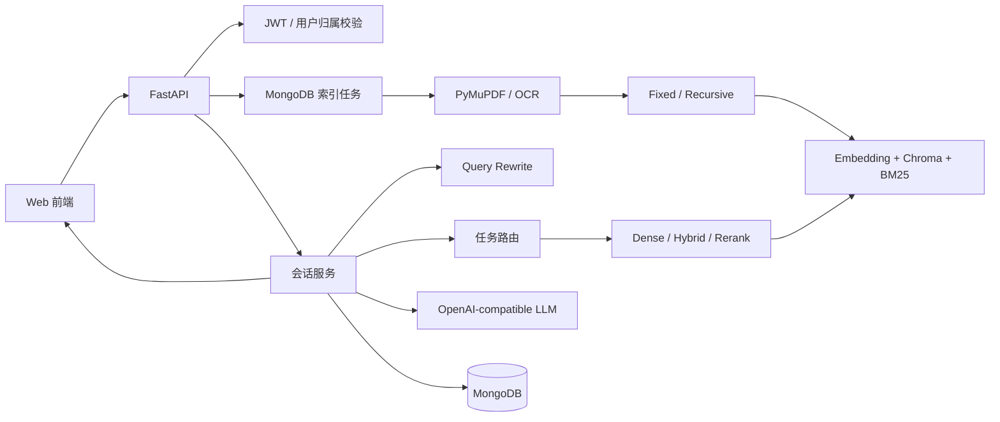

# DocRAG Agent

DocRAG 是一个面向论文、技术文档、课程资料和项目报告的多文档 RAG 应用。它把 PDF 解析、版本化切片、向量索引、混合检索、重排、会话记忆、来源持久化和离线评估串成一条可以运行和定位问题的工程链路。

系统输出用于辅助阅读，重要结论应回到原文和引用片段核验。本项目不是医学诊断系统。

## 当前交付状态（2026-10-18）

**DocRAG Harness 本地演示版已完成本轮功能与小规模对照收尾。** 在原有多文档 RAG 上增加单 Agent 研究运行循环、独立 worker、任务与证据持久化、继续研究和历史管理。启动方法见下文，完整演示见 [演示脚本](medrag/docs/demo-script.md)。

本轮未发布新的 GitHub/Hugging Face 版本。以下为 **2026-09-29 基础 RAG v1.1.0 的历史验收记录**，不代表当前 Harness 已在线部署或重新通过全量测试。

| 证据 | 当前结果 |
| --- | --- |
| GitHub 源码 | `fe2ac23f138397fae8a0b4a257fec00ab7fd1be3` |
| GitHub CI | Run `36536543292`，通过 |
| Hugging Face 部署 | `8770e28ec88e5d7797e622117cd749eace20f168` |
| `/health` | `build_commit` 与线上部署提交一致 |
| `/ready` | 200；MongoDB、Chroma、上传目录、LLM 配置均 ready |
| 线上业务闭环 | 注册、登录、上传、索引完成、提问、来源展示、历史消息均通过 |
| 本地工程测试 | 当时用户运行：374 passed、9 skipped、6 warnings |
| 固定 20 题回归 | 20/20 执行成功、无 HTTP 500；证据召回 0.632，P95 约 199.9 秒 |
| LLM Judge | 正确性 0.855、完整性 0.786、忠实性 0.989、引用正确性 0.933 |

线上验收原始报告：`eval/runs/release_acceptance/release-acceptance-20260929T075433283381Z.json`。

固定 20 题运行报告：`eval/runs/generation/generation-single_turn-20260929T085541756035Z/summary.json`。Judge 报告：`eval/runs/judge/judge-20260929T094048797812Z/summary.json`。Judge 是辅助指标，不能替代人工抽检。

## 在线演示

- Hugging Face Space：<https://maoxiao-1205-medrag.hf.space/>
- 健康检查：<https://maoxiao-1205-medrag.hf.space/health>
- API 文档：<https://maoxiao-1205-medrag.hf.space/docs>

免费实例可能休眠或冷启动。演示环境使用独立数据目录，不要上传敏感文件。

本轮 Harness 请使用下文的本地环境演示，以上线上地址保留基础 RAG 的历史部署入口。

## 已实现能力

### 文档与索引

- PyMuPDF 按页解析 PDF，低文本量页面可选 Tesseract OCR 回退。
- `fixed` 和 `recursive` 两种切片策略，保存页码、字符范围、策略和版本元数据。
- 以 `document_hash` 识别同一用户的重复文件。
- 以 `index_fingerprint` 判断切片参数、Embedding 模型和索引版本是否变化。
- 索引任务持久化在 MongoDB，`POST /pdf/index` 返回 `202 + job_id`，支持查询、重试、幂等键和 `force_reindex`。
- 每次重建写入独立 `index_generation_id`，校验完成后再切换 active generation。
- Embedding 和 Chroma 写入支持批处理。

### 检索与回答

- Dense 检索可作为基线，Hybrid 使用 BM25 + RRF 补充术语、缩写和数字匹配。
- 候选扩大后使用 `BAAI/bge-reranker-base` CrossEncoder 全局重排。
- 支持证据阈值、Query Rewrite 和 Summary Multi-Query。
- 无证据时拒答，不让 LLM 用参数知识补齐文档事实。
- assistant 消息持久化 `sources`、`rewritten_query`、`retrieval_queries` 和 `task_type`。

### 知识库与会话

- 用户可以创建、重命名和删除知识库，并关联多个文档。
- 会话可以绑定单文档或知识库，并选择知识库中的部分文档。
- JWT + Argon2 登录，后端按认证得到的 `user_id` 校验资源归属。
- 前端展示索引进度、错误状态、历史会话和可展开的来源片段。

### 单 Agent Harness（深入研究）

- 模型通过 `search_documents`、`read_evidence`、`save_research_note`、`finish_report` 选择下一步；运行层执行工具并反馈结果。
- 服务端固定用户、文档范围和索引 generation，执行中保留这些约束。
- MongoDB 保存任务、步骤与证据，独立 research worker 领取任务，支持租约恢复、取消和预算停止。
- 新任务单次模型请求最长 **600 秒**，任务总时限 **5400 秒（90 分钟，含排队）**，最多 8 次模型请求、12 次工具执行。旧任务沿用创建时保存的预算。
- 共用原有输入框和文档选择，研究过程可折叠，引用可查看原文；终态任务可继续追问，沿用原文档范围和有限上下文。
- 普通历史会话和研究记录支持删除。运行中的研究需先取消。研究入口保存在当前浏览器，完整任务保存在服务端；尚无跨设备历史列表。

```text
研究问题 → 固定范围与预算 → MongoDB 任务 → 独立 research worker
                                     ↓
                    模型选动作 → 工具执行 → 证据/笔记/反馈
                         ↑___________________↓
                              提交报告或停止
```

### H4 小规模真实模型对照

固定 RAG、LoRA、CoT 三篇论文，使用同一模型 `Qwen/Qwen3.5-35B-A3B`，比较 A 原有问答、B 固定检索流程、C Harness。3 道题共 9 组最终记录：8 组返回文本或报告，1 组因模型供应商 429 失败；返回结果中包括 1 组部分完成报告。

其中三论文比较题的观察结果：

| 方案 | 回答来源覆盖 | 模型请求 | 耗时 |
| --- | --- | --- | --- |
| A 原有问答 | 1 篇 | 3 次 | 178 秒 |
| B 固定检索 | 2 篇 | 1 次 | 66 秒 |
| C Harness | 3 篇 | 8 次 | 441 秒 |

这说明该样例中反馈检索扩大了文档覆盖，也增加了调用和等待。事实题 A/B 已能回答，不能据此宣称 Harness 全面提高准确率。耗时含供应商等待、数据库检查点及限流间隔；未逐条核验全部引用。

运行入口：[harness_pilot.py](eval/runners/harness_pilot.py)。本机记录：`eval/runs/harness/h4_pilot_20261018/overview.json` 与各组 JSON；运行产物不提交 Git。实验使用隔离任务集合，结果不会自动出现在前端研究历史中。

## 系统流程

```text
PDF 上传
  → 文档 hash 与索引任务
  → PyMuPDF / OCR 解析
  → fixed / recursive 切片
  → Embedding + Chroma + BM25
  → 会话历史与 Query Rewrite
  → Agent Router（qa / summary / report / term / source_check）
  → Dense / Hybrid 召回
  → RRF 去重与 CrossEncoder Rerank
  → Prompt + LLM
  → 保存回答、来源和检索调试信息
```



## 技术栈

| 层 | 技术 |
| --- | --- |
| API | Python 3.11、FastAPI、Uvicorn |
| 解析 | PyMuPDF、可选 Tesseract OCR |
| Embedding | SiliconFlow OpenAI-compatible API、`BAAI/bge-m3` |
| 检索 | Chroma、BM25、RRF |
| Rerank | Sentence Transformers CrossEncoder、`BAAI/bge-reranker-base` |
| 业务数据 | MongoDB / PyMongo |
| 前端 | HTML、CSS、JavaScript |
| 验证 | pytest、Playwright、固定 RAG 评估集 |
| 部署 | Docker、Hugging Face Space |

## 目录

```text
MedRag/
├─ medrag/backend/       # FastAPI、业务服务、Prompt、Stores
├─ medrag/frontend/      # 单页前端
├─ medrag/docs/          # 项目说明、架构、演示与发布记录
├─ eval/                 # 固定数据集、评估 runner、指标与验收报告
├─ tests/                # 单元、接口契约和前端 smoke 测试
├─ runtime/              # 本地运行数据，不提交 Git
├─ Dockerfile
└─ README.md
```

## 本地运行

### 安装与配置

```powershell
Set-Location D:\MedRag
conda activate medrag
D:\Anaconda\envs\medrag\python.exe -m pip install -r medrag\backend\requirements.txt
if (!(Test-Path medrag\backend\.env)) { Copy-Item medrag\backend\.env.example medrag\backend\.env }
```

至少配置：

```env
APP_VERSION=dev
BUILD_COMMIT=local
MONGODB_URI=mongodb://127.0.0.1:27017
MONGODB_DB_NAME=medrag_local
CHROMA_DIR=D:/MedRag/runtime/chroma_db
UPLOAD_DIR=D:/MedRag/runtime/uploads
JWT_SECRET_KEY=replace-with-a-long-random-secret
REWRITE_LLM_API_KEY=...
ANSWER_LLM_API_KEY=...
```

本地和线上必须使用不同的 MongoDB 数据库名、Chroma 目录和上传目录。`.env`、密钥、上传文件、向量库和日志不得提交 Git。

### 一条命令启动（推荐）

```powershell
Set-Location D:\MedRag
D:\Anaconda\envs\medrag\python.exe medrag\backend\start_services.py
```

统一入口自动启动 API 和 research worker，访问 `http://127.0.0.1:8000/`。如果之前已经分开启动，请先在原终端停止旧进程，避免端口占用。

### 启动（两个终端）

需要分别查看日志时，也可以使用以下方式，和统一入口二选一。

终端 1：API 和前端。

```powershell
Set-Location D:\MedRag\medrag\backend
D:\Anaconda\envs\medrag\python.exe -m uvicorn main:app --host 127.0.0.1 --port 8000
```

终端 2：深入研究 worker，保持运行。

```powershell
Set-Location D:\MedRag\medrag\backend
D:\Anaconda\envs\medrag\python.exe -m harness.research_worker
```

访问 `http://127.0.0.1:8000/`、`/docs`、`/health` 和 `/ready`。前端由 API 提供，无需单独启动 npm。API 不会自动启动 research worker；只启动 API 时普通问答可用，研究任务会等待 worker。两个进程使用同一 `.env`，MongoDB 需支持事务（副本集或 Atlas）。

### Hugging Face Docker Space

Dockerfile 使用统一入口自动启动 API（`0.0.0.0:7860`）和 research worker，无需手动运行第二条命令，也无需另建 Space。worker 不开放 HTTP 端口，两个进程共享容器内的 Chroma、上传目录和环境变量。

部署时同步当前源码与 Dockerfile，在 Space Secrets 中保留 MongoDB、JWT、Embedding 和 LLM 密钥配置，然后重新构建。启动日志应出现 `service_started name=api` 和 `service_started name=research_worker`。登录后提交一条研究任务，确认从排队进入执行，再检查报告或明确的失败状态。

本次仅修改部署入口，尚未执行 HF 重建验收。Space 休眠时 worker 也会停止；容器重启不会保留普通临时磁盘，MongoDB 中保存的任务不等于 Chroma 索引也已持久化。平台说明见 [HF Docker Spaces 文档](https://huggingface.co/docs/hub/spaces-sdks-docker)。

## 主要接口

| 方法 | 路径 | 用途 |
| --- | --- | --- |
| GET | `/health` | 返回版本和构建提交号 |
| GET | `/ready` | 检查 MongoDB、Chroma、上传目录和 LLM 配置 |
| POST | `/auth/register`、`/auth/login` | 注册和登录 |
| POST | `/pdf/index` | 创建或复用索引任务 |
| GET | `/ingestion-jobs/{job_id}` | 查询索引进度和错误 |
| POST | `/ingestion-jobs/{job_id}/retry` | 重试失败任务 |
| POST | `/knowledge-bases` | 创建知识库 |
| POST | `/conversations` | 创建单文档或知识库会话 |
| POST | `/conversations/{id}/ask` | 多轮检索问答 |
| GET | `/conversations/{id}/messages` | 获取历史消息和来源 |
| DELETE | `/conversations/{id}` | 删除会话及其消息和来源 |
| POST | `/research-tasks` | 创建研究任务，可传 parent_task_id 继续研究 |
| POST | `/research-tasks/{task_id}/run` | 将任务加入执行队列 |
| GET | `/research-tasks/{task_id}` | 查询状态、步骤、报告和证据 |
| POST | `/research-tasks/{task_id}/cancel` | 取消研究任务 |
| DELETE | `/research-tasks/{task_id}` | 删除非运行中任务及其步骤和证据 |

完整请求字段以在线 Swagger 为准。

## 验证命令

只读静态检查：

```powershell
Set-Location D:\MedRag
D:\Anaconda\envs\medrag\python.exe -m compileall -q medrag\backend eval tests
git diff --check
```

历史基础版本的 pytest 记录为 `374 passed, 9 skipped, 6 warnings`，本轮未重跑全量 pytest。静态检查不能代替测试；仅在明确需要重新运行时使用：

```powershell
D:\Anaconda\envs\medrag\python.exe -m pytest -q
```

固定评估和线上验收入口见 [评估说明](eval/README.md)。运行产物写入 `eval/runs/`，不应提交 Git。

## 已知限制

- 历史基础版本固定 20 题运行 20/20 执行成功且无 HTTP 500；证据召回为 0.632，P95 延迟约 199.9 秒。拒答启发式把 RAG-01 的“文档未明确说明”误判为拒答；Judge 对该答案四项均评 1.0。真正的无答案误答为 LORA-04。Judge 平均正确性 0.855、完整性 0.786；低分集中在 CoT 定义和跨文档总结。此前 5/20 的结果保留为 MongoDB 依赖故障历史。
- 20 题运行只证明接口执行情况，不能把执行成功率当作答案正确率；Judge 和人工评分需单独查看。
- 评估集规模有限，Summary、跨文档和复杂版面文档的证据覆盖仍需扩大样本。
- 线上容量、并发、长期磁盘可靠性和复杂表格/图片理解尚未完成基准。
- 索引 worker 仍在 FastAPI 应用进程内运行；MongoDB Job 状态可恢复，但不等同于独立 worker 集群。
- JWT 当前保存在浏览器 `localStorage`，尚未实现 HttpOnly Cookie、Refresh Token、Token 吊销和 RBAC。
- Harness 报告完成状态表示结构要求满足，引用与结论仍需核验；免费模型可能限流或超时。上述限制保留为使用说明，不作为本轮演示版收尾的新增门槛。

## 文档入口

- [项目说明](medrag/docs/项目说明.md)
- [系统架构](medrag/docs/系统架构图.md)
- [Harness 演示脚本](medrag/docs/demo-script.md)
- [Harness 实现记录](medrag/docs/research-harness-h1.md)
- [v1.1.0 结项记录](medrag/docs/release-v1.1.0.md)
- [评估说明](eval/README.md)
