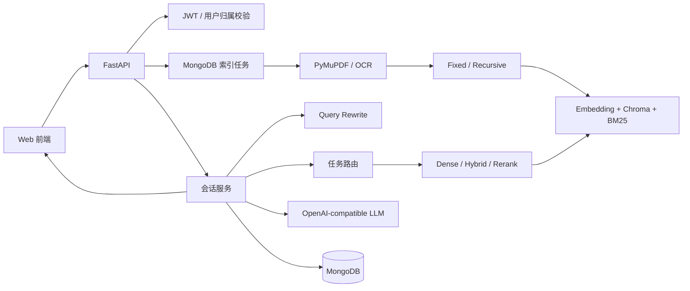

# DocRAG Agent

DocRAG 是一个面向论文、技术文档、课程资料和项目报告的多文档 RAG 应用。它把 PDF 解析、版本化切片、向量索引、混合检索、重排、会话记忆、来源持久化和离线评估串成一条可以运行和定位问题的工程链路。

系统输出用于辅助阅读，重要结论应回到原文和引用片段核验。本项目不是医学诊断系统。

## 当前版本结论

当前版本标记为 **v1.1.0 演示候选（条件结项）**。主链路和最新固定 20 题的接口执行均已验收，但评估质量、延迟和容量证据仍不足以称为严格生产发布。

| 证据 | 当前结果 |
| --- | --- |
| GitHub 源码 | `fe2ac23f138397fae8a0b4a257fec00ab7fd1be3` |
| GitHub CI | Run `36536543292`，通过 |
| Hugging Face 部署 | `8770e28ec88e5d7797e622117cd749eace20f168` |
| `/health` | `build_commit` 与线上部署提交一致 |
| `/ready` | 200；MongoDB、Chroma、上传目录、LLM 配置均 ready |
| 线上业务闭环 | 注册、登录、上传、索引完成、提问、来源展示、历史消息均通过 |
| 本地工程测试 | 用户在当前阶段运行：374 passed、9 skipped、6 warnings |
| 固定 20 题回归 | 20/20 执行成功、无 HTTP 500；证据召回 0.632，P95 约 199.9 秒 |
| LLM Judge | 正确性 0.855、完整性 0.786、忠实性 0.989、引用正确性 0.933 |

线上验收原始报告：`eval/runs/release_acceptance/release-acceptance-20260929T075433283381Z.json`。

固定 20 题运行报告：`eval/runs/generation/generation-single_turn-20260929T085541756035Z/summary.json`。Judge 报告：`eval/runs/judge/judge-20260929T094048797812Z/summary.json`。Judge 是辅助指标，不能替代人工抽检。

## 在线演示

- Hugging Face Space：<https://maoxiao-1205-medrag.hf.space/>
- 健康检查：<https://maoxiao-1205-medrag.hf.space/health>
- API 文档：<https://maoxiao-1205-medrag.hf.space/docs>

免费实例可能休眠或冷启动。演示环境使用独立数据目录，不要上传敏感文件。

## 已实现能力

### 文档与索引

- PyMuPDF 按页解析 PDF，低文本量页面可选 Tesseract OCR 回退。
- `fixed` 和 `recursive` 两种切片策略，保存页码、字符范围、策略和版本元数据。
- 以 `document_hash` 识别同一用户的重复文件。
- 以 `index_fingerprint` 判断切片参数、Embedding 模型和索引版本是否变化。
- 索引任务持久化在 MongoDB，`POST /pdf/index` 返回 `202 + job_id`，支持查询、重试、幂等键和 `force_reindex`。
- 每次重建写入独立 `index_generation_id`，校验完成后再切换 active generation。
- Embedding 和 Chroma 写入支持批处理。

### 检索与回答

- Dense 检索可作为基线，Hybrid 使用 BM25 + RRF 补充术语、缩写和数字匹配。
- 候选扩大后使用 `BAAI/bge-reranker-base` CrossEncoder 全局重排。
- 支持证据阈值、Query Rewrite 和 Summary Multi-Query。
- 无证据时拒答，不让 LLM 用参数知识补齐文档事实。
- assistant 消息持久化 `sources`、`rewritten_query`、`retrieval_queries` 和 `task_type`。

### 知识库与会话

- 用户可以创建、重命名和删除知识库，并关联多个文档。
- 会话可以绑定单文档或知识库，并选择知识库中的部分文档。
- JWT + Argon2 登录，后端按认证得到的 `user_id` 校验资源归属。
- 前端展示索引进度、错误状态、历史会话和可展开的来源片段。

## 系统流程

```text
PDF 上传
  → 文档 hash 与索引任务
  → PyMuPDF / OCR 解析
  → fixed / recursive 切片
  → Embedding + Chroma + BM25
  → 会话历史与 Query Rewrite
  → Agent Router（qa / summary / report / term / source_check）
  → Dense / Hybrid 召回
  → RRF 去重与 CrossEncoder Rerank
  → Prompt + LLM
  → 保存回答、来源和检索调试信息
```



## 技术栈

| 层 | 技术 |
| --- | --- |
| API | Python 3.11、FastAPI、Uvicorn |
| 解析 | PyMuPDF、可选 Tesseract OCR |
| Embedding | SiliconFlow OpenAI-compatible API、`BAAI/bge-m3` |
| 检索 | Chroma、BM25、RRF |
| Rerank | Sentence Transformers CrossEncoder、`BAAI/bge-reranker-base` |
| 业务数据 | MongoDB / PyMongo |
| 前端 | HTML、CSS、JavaScript |
| 验证 | pytest、Playwright、固定 RAG 评估集 |
| 部署 | Docker、Hugging Face Space |

## 目录

```text
MedRag/
├─ medrag/backend/       # FastAPI、业务服务、Prompt、Stores
├─ medrag/frontend/      # 单页前端
├─ medrag/docs/          # 项目说明、架构、演示与发布记录
├─ eval/                 # 固定数据集、评估 runner、指标与验收报告
├─ tests/                # 单元、接口契约和前端 smoke 测试
├─ runtime/              # 本地运行数据，不提交 Git
├─ Dockerfile
└─ README.md
```

## 本地运行

### 安装与配置

```powershell
Set-Location D:\MedRag
conda activate medrag
D:\Anaconda\envs\medrag\python.exe -m pip install -r medrag\backend\requirements.txt
Copy-Item medrag\backend\.env.example medrag\backend\.env
```

至少配置：

```env
APP_VERSION=dev
BUILD_COMMIT=local
MONGODB_URI=mongodb://127.0.0.1:27017
MONGODB_DB_NAME=medrag_local
CHROMA_DIR=D:/MedRag/runtime/chroma_db
UPLOAD_DIR=D:/MedRag/runtime/uploads
JWT_SECRET_KEY=replace-with-a-long-random-secret
REWRITE_LLM_API_KEY=...
ANSWER_LLM_API_KEY=...
```

本地和线上必须使用不同的 MongoDB 数据库名、Chroma 目录和上传目录。`.env`、密钥、上传文件、向量库和日志不得提交 Git。

### 启动

```powershell
Set-Location D:\MedRag\medrag\backend
D:\Anaconda\envs\medrag\python.exe -m uvicorn main:app --host 127.0.0.1 --port 8000
```

访问 `http://127.0.0.1:8000/`、`/docs`、`/health` 和 `/ready`。

## 主要接口

| 方法 | 路径 | 用途 |
| --- | --- | --- |
| GET | `/health` | 返回版本和构建提交号 |
| GET | `/ready` | 检查 MongoDB、Chroma、上传目录和 LLM 配置 |
| POST | `/auth/register`、`/auth/login` | 注册和登录 |
| POST | `/pdf/index` | 创建或复用索引任务 |
| GET | `/ingestion-jobs/{job_id}` | 查询索引进度和错误 |
| POST | `/ingestion-jobs/{job_id}/retry` | 重试失败任务 |
| POST | `/knowledge-bases` | 创建知识库 |
| POST | `/conversations` | 创建单文档或知识库会话 |
| POST | `/conversations/{id}/ask` | 多轮检索问答 |
| GET | `/conversations/{id}/messages` | 获取历史消息和来源 |

完整请求字段以在线 Swagger 为准。

## 验证命令

只读静态检查：

```powershell
Set-Location D:\MedRag
D:\Anaconda\envs\medrag\python.exe -m compileall -q medrag\backend eval tests
git diff --check
```

用户已在当前版本执行过全量 pytest，结果为 `374 passed, 9 skipped, 6 warnings`。如需在后续提交上重新确认，使用：

```powershell
D:\Anaconda\envs\medrag\python.exe -m pytest -q
```

固定评估和线上验收入口见 [评估说明](eval/README.md)。运行产物写入 `eval/runs/`，不应提交 Git。

## 已知限制

- 最新固定 20 题运行 20/20 执行成功且无 HTTP 500；证据召回为 0.632，P95 延迟约 199.9 秒，1 个可回答问题被误拒答。Judge 平均正确性 0.855、完整性 0.786；低分集中在 CoT 定义和跨文档总结。此前 5/20 的结果保留为 MongoDB 依赖故障历史。
- 20 题运行只证明接口执行情况，不能把执行成功率当作答案正确率；Judge 和人工评分需单独查看。
- 评估集规模有限，Summary、跨文档和复杂版面文档的证据覆盖仍需扩大样本。
- 线上容量、并发、长期磁盘可靠性和复杂表格/图片理解尚未完成基准。
- 索引 worker 仍在 FastAPI 应用进程内运行；MongoDB Job 状态可恢复，但不等同于独立 worker 集群。
- JWT 当前保存在浏览器 `localStorage`，尚未实现 HttpOnly Cookie、Refresh Token、Token 吊销和 RBAC。

## 文档入口

- [项目说明](medrag/docs/项目说明.md)
- [系统架构](medrag/docs/系统架构图.md)
- [三分钟演示脚本](medrag/docs/demo-script.md)
- [v1.1.0 结项记录](medrag/docs/release-v1.1.0.md)
- [评估说明](eval/README.md)
