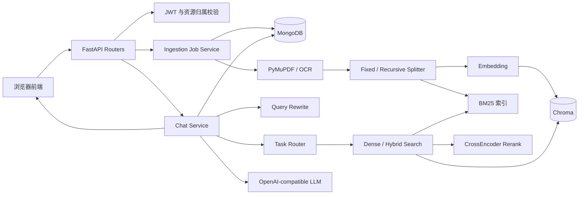
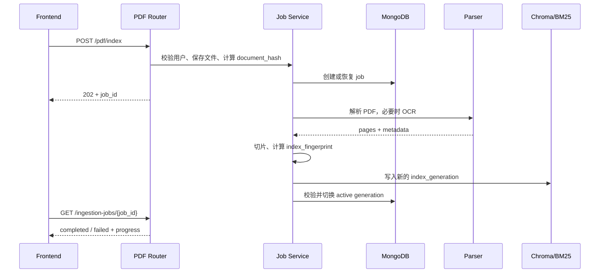
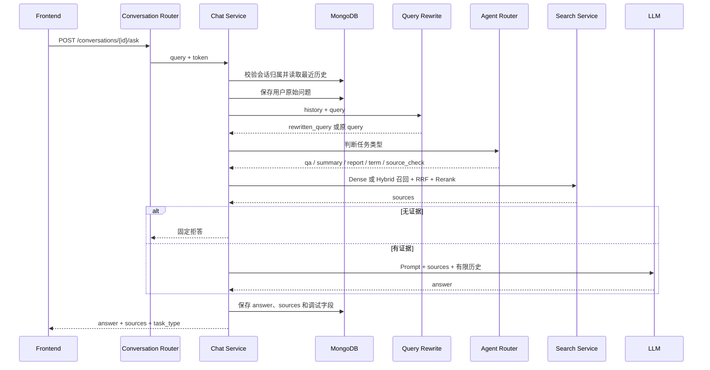

# DocRAG 系统架构

## 总体数据流



## 索引任务链路



`document_hash` 负责重复文件识别；`index_fingerprint` 负责配置一致性；`index_generation_id` 负责新旧索引切换。写入新代次失败时，旧 active 代次不应被提前删除。

## 问答链路



## 检索边界

```text
Query Rewrite
  → BGE query embedding / BM25
  → user_id + kb_id + optional document_ids 过滤
  → Dense 与 Sparse 候选
  → RRF 合并和去重
  → CrossEncoder 全局重排
  → evidence threshold
  → Prompt context
```

所有检索都必须保留 `user_id` 过滤。知识库会话不指定文档时检索整个知识库，指定文档时使用 `document_id in [...]` 限定范围。

## 模块边界

| 层 | 责任 |
| --- | --- |
| `routers/` | 请求校验、认证依赖、状态码和响应 |
| `services/` | 文档处理、索引、检索、Prompt、LLM 和会话编排 |
| `stores/` | MongoDB 连接、集合读写和索引 |
| `frontend/` | 上传、任务进度、会话、错误和 sources 展示 |
| `eval/` | 固定数据集、指标、Judge 和线上验收，不参与业务运行 |

## 当前风险

- Ingestion worker 仍在 FastAPI 进程内运行，尚非独立 worker 服务。
- 最新 20 题运行 20/20 执行成功；此前 15 个 HTTP 500 的运行与 MongoDB 连接故障相关，仍作为历史 Reliability 风险记录。
- OCR、Embedding 和 Reranker 的 CPU/网络成本尚未完成容量基准。
- 免费 Space 的本地 Chroma 和上传目录不保证长期持久化。
